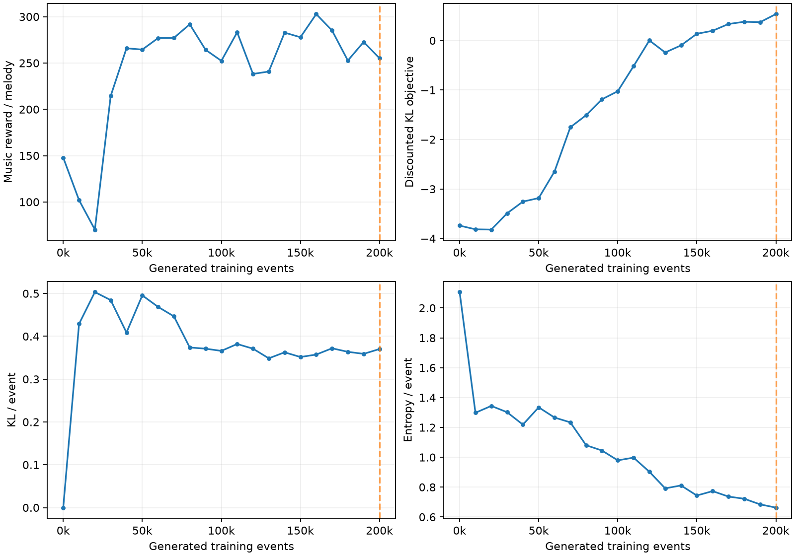

# Melody generation with Sequence Tutor

A PyTorch melody generator trained on Hooktheory MIDI melodies, then fine-tuned
with recurrent Psi learning from [Sequence Tutor](https://proceedings.mlr.press/v70/jaques17a/jaques17a.pdf).

## Results

One seed, 200,000 generated training events and 49,745 updates on an NVIDIA H100.
Evaluation uses 1,000 fresh paired generation seeds.

| Metric | Pretrained baseline | Psi learning |
|---|---:|---:|
| Music reward per melody | 201.28 | 253.54 |
| Out of key onsets | 9.98% | 1.00% |
| Distinct pitches per melody | 17.18 | 8.78 |
| Event entropy | 2.106 | 0.670 |

The reward improved by 26%, while pitch variety and policy entropy decreased.
These are composition proxies; listening preference has not been measured.

[Full report](results/psi_seed42/report.md) ·
[RL MIDI sample](results/psi_seed42/psi/melody_000.mid) ·
[Baseline MIDI sample](results/psi_seed42/baseline/melody_000.mid)



The results directory includes 20 paired MIDI samples, all 2,000 evaluation
sequences, reward metrics, configuration, training history, and validation logs.
Melodies have eight bars in 4/4 at 80 BPM: a 24-second horizon, including silence.

## Run

Use Python 3.13. The pinned PyTorch build supports CUDA 12.8 and CPU execution.

```bash
python3 -m venv .venv
source .venv/bin/activate
pip install -r requirements.txt
python rl_melody.py generate --checkpoint checkpoints/psi_seed42.pt \
  --device cpu --count 10 --output-dir generated/psi
```

The included inference checkpoints allow sampling without downloading or
preparing the training data:

- `checkpoints/mle_256.pt`: pretrained 256-unit melody model.
- `checkpoints/psi_seed42.pt`: trained Psi model plus its frozen prior.

These compact exports contain model weights and metadata. Optimizer and replay
states are omitted, so they support generation and evaluation; training resume
requires a full run checkpoint.

```bash
python -m unittest -v test_psi_learning
python rl_melody.py compare --checkpoint checkpoints/psi_seed42.pt \
  --device cpu --output-dir generated/comparison
python rl_melody.py train --checkpoint checkpoints/mle_256.pt \
  --device auto --output-dir runs/psi_seed42
```

Select `--device cuda:0` or `--device cuda:1` explicitly when needed. `auto` uses
GPU 1 when two GPUs are present, GPU 0 when one is present, otherwise CPU.
Training settings are exposed by `python rl_melody.py train --help`.
Use `--reward-config config.json` for partial reward coefficient overrides.

To resume a full training checkpoint:

```bash
python rl_melody.py train --resume runs/psi_seed42/last.pt \
  --output-dir runs/psi_seed42 --total-events 200000 --device auto
```

## Architecture

All three RL networks share one architecture:

```
38-dimensional one-hot event -> single-layer LSTM (256 units) -> Linear(256, 38)
```

There are 36 MIDI pitches (48–83), a continuation event, and a note-off event.
One event spans a sixteenth note. Each network has 312,870 parameters.

| Network | Role | Weight updates |
|---|---|---|
| Online Psi | Supplies action scores; softmax defines the generation policy | Adam |
| Target Psi | Supplies future values for the training target | 1% interpolation toward online weights |
| Frozen prior | Supplies pretrained next-event log probabilities | Fixed |

Music rewards are handwritten functions. All networks start from the same
pretrained model. Replay stores full histories, and each update recomputes
online and target recurrent states independently. Batch size 32 means 32 sampled
experiences, each with its prefix, action, reward, and terminal flag.

The Psi target is:

```
log p_prior(action | history) + music_reward / c
    + gamma * (1 - terminal) * logsumexp(Psi_target(next_history, :))
```

Defaults: c=0.5, gamma=0.5, Adam learning rate 1e-4, gradient clipping at 5,
replay capacity 100,000, warmup 1,024 events, one update per four new events,
and a 128-event horizon including the fixed C4 primer. The primer receives no
reward. Evaluation runs every 10,000 training events; checkpoint selection uses
discounted reward/c minus exact vocabulary KL. Gamma=0.5 emphasizes early events.

## Data and reward provenance

[Baseline documentation](BASELINE.md) describes data preparation and supervised
training. Existing Hooktheory archives and source metadata are retained. To
prepare the supervised dataset, run `python prepare_melody_data.py`; to train the
baseline, run `python train_note_rnn.py`.

[Reward source notes](references/README.md) document the Magenta revision,
Apache-2.0 source license, coefficients, and our deliberate timing/event
adaptations. This is an initial experiment using the paper's Psi objective,
with our dataset, 256-unit prior, and documented reward adaptations.

## Validation

14 RL tests pass, covering numerical targets, terminal masking, replay alignment,
frozen weights, target interpolation, exact CPU resumption, evaluation seeds,
reward timing, and MIDI round trips. A command-line resume run also matches an
uninterrupted run exactly. All 40 exported MIDI files were read back to validate
monophony, pitch bounds, grid timing, and the named MELODY track.

See `results/psi_seed42/validation.json` and `tests.log` for the recorded checks.
